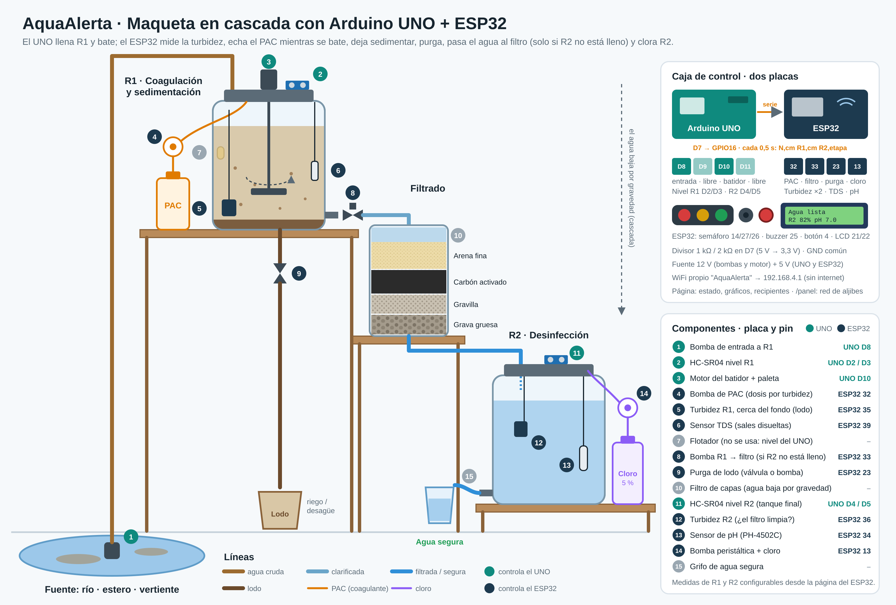

# Arduino UNO + ESP32

El prototipo usa dos placas que se reparten el trabajo:

| Placa | Qué hace |
|---|---|
| **Arduino UNO** (`uno/AquaAlerta_UNO/AquaAlerta_UNO.ino`) | Mide el nivel de R1 y de R2 (tanque final). Si R1 está vacío prende la **bomba de entrada** y la apaga al llenarse; luego prende el **motor del batidor** por un tiempo |
| **ESP32** (entorno `esp32dev_uno`) | Mide la **turbidez** de R1 y R2, el **pH** y el **TDS**. Mientras el UNO bate, prende la **bomba de PAC** (GPIO32) con la dosis calculada según la turbidez y los litros de R1. Luego deja **sedimentar**, purga el lodo y prende la **bomba hacia el filtro** solo si R1 está clara y **R2 no está lleno**. Del filtro a R2 el agua cae por gravedad. Después dosifica el **cloro** según el pH. Muestra todo en la página y lo envía a ThingSpeak |



Los números verdes los controla el UNO; los azul oscuro, el ESP32. La maqueta original solo-ESP32 sigue en
`maqueta-cascada.png`.

## Comunicación

El UNO manda cada 0,5 s una línea de texto a 9600 baudios:

```
N,<cm R1>,<cm R2>,<etapa>
```

- `cm R1`, `cm R2`: distancia del sensor al agua; `-1` si el sensor no responde.
- `etapa`: `0` espera · `1` llenando R1 · `2` batiendo (el ESP32 echa el PAC) · `3` terminó de batir.

Si el ESP32 deja de recibir mensajes por 5 s, marca el nivel «sin respuesta» y no pasa agua al filtro.

## Conexiones

| UNO | ESP32 | Nota |
|---|---|---|
| D7 (TX) | GPIO16 | **Con divisor 1 kΩ / 2 kΩ**: el UNO da 5 V y el ESP32 acepta 3,3 V |
| GND | GND | Tierra común, obligatoria |

Divisor: D7 → 1 kΩ → GPIO16 → 2 kΩ → GND.

| Pin del UNO | Conectado a |
|---|---|
| D2 / D3 | Ultrasonido R1 (TRIG / ECHO) |
| D4 / D5 | Ultrasonido R2 (TRIG / ECHO) |
| D8 | Relé de la bomba de entrada a R1 |
| D9 | Relé libre |
| D10 | Relé del motor del batidor |
| D11 | 4.º relé (libre) |

Si el equipo ya cableó otros pines, se cambian al inicio del sketch. Si ya tiene su propio programa, basta con copiar
`enviarAlEsp()` y llamarla cada 500 ms con sus distancias y su etapa.

En el ESP32 quedan sin uso los ultrasonidos, el flotador, la válvula de entrada y el agitador.
Sus relés de **bomba de PAC (GPIO32)**, **purga (GPIO23)**, **transferencia al filtro (GPIO33)** y **goteo de cloro (GPIO13)** siguen igual.

## Cargar los programas

```bash
pio run -e esp32dev_uno -t upload        # ESP32 en modo UNO (tiempos de demo)
```

El UNO se carga desde el Arduino IDE abriendo `uno/AquaAlerta_UNO/AquaAlerta_UNO.ino`.

Antes de usarlo, ajustar en el sketch:

- `R1_VACIO_CM` / `R1_LLENO_CM`: medir con regla la distancia del sensor al agua con R1 vacío y lleno.
- `T_BATIDO_MS`: tiempo del batido; tiene que alcanzar para que el ESP32 eche toda la dosis de PAC.
- En el ESP32, `PAC_CAUDAL_ML_MIN` (`include/config.h`): ml que da la bomba de PAC en 1 minuto (medirlo).
- `RELE_ACTIVO_ALTO`: `false` si el relé se activa con LOW (lo más común).

En la página del ESP32, en «Recipientes», cargar las medidas de R1 y R2 con los mismos valores para que los litros salgan bien.

## Limitaciones

- Si el batido termina antes de completar la dosis, el ESP32 termina de echar el PAC sin agitación y luego sedimenta.
- La simulación de Wokwi de la raíz (`diagram.json`) sigue siendo la versión solo-ESP32. El cableado con el UNO está
  en `wokwi-uno/diagram.json` (en VS Code: «Wokwi: Select Config File» → `wokwi-uno/wokwi.toml`, después de
  `pio run -e esp32dev_uno`). Ahí el UNO sirve de referencia del cableado: si la simulación no le carga su programa,
  el ESP32 marca los niveles «sin respuesta».
